<!-- PERFIL · Jhordan Gabriel Bandeira · github.com/devBandeiraa -->

  

  

## Sobre

**Desenvolvedor Backend Júnior (Node.js, TypeScript e NestJS)** com experiência em pagamentos, integrações e IA aplicada; atuo também no frontend com React.

Na Backlgrs, rastreei pedidos que travavam entre e-commerce, gateway de pagamento e ERP: eram mais de 15 incidentes por semana em produção, em cinco projetos ao mesmo tempo. Depois construí o sistema que eu queria ter naquela época: o **[Reconcilia](https://github.com/devBandeiraa/reconcilia)**.

| | |
|---|---|
| **Hoje** | Fullstack & AI Engineer na BNW: backend de uma plataforma SaaS em Node.js e TypeScript e agentes de IA com tool calling |
| **Busco** | Vagas de backend ou full stack em fintechs, empresas de IA e startups |
| **Onde** | Boituva, SP · remoto, híbrido ou presencial em Sorocaba e região |
| **Formação** | Ciência da Computação · UNIP · conclusão em 2027 |
| **Estudando** | RAG e IA com Python |

| **15+** | **5** | **10–15** | **115** |
|:---:|:---:|:---:|:---:|
| incidentes por semana resolvidos em produção | projetos SFCC sustentados em paralelo | consultas SQL otimizadas por semana | testes automatizados no Reconcilia |

## Projetos em destaque

### 1. [Reconcilia](https://github.com/devBandeiraa/reconcilia) · conciliação de pagamentos com IA

[Demo ao vivo](https://reconcilia-seven.vercel.app) · [Documentação da API](https://reconcilia-api.onrender.com/docs) · [Código](https://github.com/devBandeiraa/reconcilia)

Encontra pagamentos que não batem entre loja, gateway e ERP: webhook perdido, webhook duplicado, valor divergente e captura de pedido já cancelado. Um agente de IA investiga cada caso e a correção só é executada depois que uma pessoa aprova.

- **Idempotência no banco:** o mesmo webhook 50 vezes em paralelo vira 1 linha, 1 job e 1 aplicação
- **Ledger em partidas dobradas** que sempre fecha em zero, garantido por trigger no PostgreSQL
- **Agente de IA só de leitura:** as ferramentas rodam em transação `READ ONLY` e a ação só é executada após aprovação humana, com auditoria
- **115 testes automatizados**, 97 deles contra um PostgreSQL real, com CI no GitHub Actions e 14 decisões de arquitetura documentadas (ADRs)
- **No ar com custo zero:** web na Vercel, API e worker no Render, banco na Neon

`NestJS` `Next.js` `TypeScript` `Prisma` `PostgreSQL` `pg-boss` `Zod` `Vitest` `LLMs`

### 2. [Hash Financeiro](https://github.com/devBandeiraa/hash-financeiro) · finanças pessoais com agente de IA e servidor MCP

[Código](https://github.com/devBandeiraa/hash-financeiro)

Importa o extrato do banco em CSV ou PDF, categoriza cada lançamento e mostra em um dashboard para onde o dinheiro foi. Um agente conversacional responde perguntas consultando os dados reais do usuário.

- **Servidor MCP próprio com OAuth:** o agente interno e clientes externos (como o Claude Desktop) usam as mesmas ferramentas, e a escrita só acontece com confirmação
- **Categorização determinística por regras:** a IA só propõe o que o motor não pegou, e a sugestão aceita vira regra
- **Reimportar não duplica:** hash SHA-256 de cada lançamento com `UNIQUE` no banco como garantia final
- **Dados isolados por RLS** em toda tabela financeira, com exclusão total dos dados pelo próprio usuário (LGPD)

`TypeScript` `React 19` `TanStack Start` `Supabase` `PostgreSQL` `MCP` `Zod` `Vitest` `LLMs`

### 3. [ticket-platform](https://github.com/devBandeiraa/ticket-platform) · venda de ingressos em microsserviços sem overselling

[Código](https://github.com/devBandeiraa/ticket-platform)

Resolve o problema de não vender o mesmo assento duas vezes quando centenas de pessoas compram no mesmo segundo. A garantia mora no PostgreSQL e continua valendo com o Redis fora do ar.

- **`UPDATE` condicional no PostgreSQL** em vez de ler, decidir e gravar; o lock distribuído no Redis é só otimização
- **461 testes e 89% de cobertura**, com 200 threads disputando o mesmo assento contra PostgreSQL, Redis e RabbitMQ reais via Testcontainers
- **Consistência entre serviços** com transactional outbox, idempotência, DLQ, circuit breaker e rate limiting
- **Observabilidade de ponta a ponta:** tracing com OpenTelemetry e Jaeger, métricas no Prometheus e painéis no Grafana

`Java 17` `Spring Boot 3` `PostgreSQL` `Redis` `RabbitMQ` `React 19` `Docker` `Kubernetes`

Outros projetos estão na aba de <a href="https://github.com/devBandeiraa?tab=repositories">repositórios</a>.

## Experiência

### Desenvolvedor Backend B2C · Backlgrs

`jan/2026 – jul/2026` · remoto

A Backlgrs implementa e sustenta lojas de e-commerce B2C de alta demanda em Salesforce Commerce Cloud. Atuei em cinco projetos ao mesmo tempo, falando direto com os clientes e apresentando sprints.

**Problema:** cada loja depende de ERP, gateway de pagamento, hub de marketplaces e plataforma de frete. Quando um desses elos falha, o pedido trava e os dados deixam de bater entre os sistemas. Eram mais de 15 incidentes por semana em produção.

**Como resolvi:**

- Rastreei cada incidente pelos logs entre plataforma, ERP e gateway até a causa-raiz, com correção validada em sandbox antes do deploy
- Automatizei jobs de sincronização de pedidos, pagamentos e estoque com o ERP, eliminando etapas manuais e reduzindo divergências entre sistemas
- Mantive as integrações com ERP, Anymarket (marketplaces), Intelipost (frete) e gateway Braspag, cobrindo Pix, cartão e parcelamento
- Implementei o método de pagamento JS Card no checkout SFCC
- Corrigi validações de checkout e o tratamento de datas/timezone que geravam divergências em pedidos
- Corrigi bugs em models, controllers e cartridges e entreguei novas funcionalidades no back-end (JavaScript/SFRA, Node.js) e na camada ISML
- Migrei componentes front-end de Bootstrap 4 para 5 e mantive os componentes Vue.js da storefront, sem regressões na navegação
- Trabalhei com QA e Analistas Funcionais em Scrum (Jira), com code review e versionamento em Git

### Desenvolvedor de Software (Dados e Integrações) · Guardian RH

`jul/2024 – jan/2026` · estágio remoto

A Guardian RH oferece uma solução de automação para conferência, gestão e otimização da folha de pagamento, integrada ao ERP do cliente (TOTVS RM, Protheus, SAP). Estagiei no time de dados e integrações.

**Problema:** a conferência da folha depende dos dados extraídos desses ERPs. Consultas SQL lentas ou que retornavam resultados incorretos comprometiam relatórios e integrações, e os dados precisavam ser migrados entre sistemas corporativos.

**Como resolvi:**

- Otimizei e corrigi de 10 a 15 consultas SQL por semana em Oracle e SQL Server (joins complexos, subqueries, procedures e funções analíticas), com ganho de performance e correção dos resultados
- Diagnostiquei a causa do erro ou do gargalo antes de ajustar cada consulta, atendendo o time e as áreas de negócio
- Construí pipelines de ETL com Azure Data Factory para migrar dados entre sistemas corporativos
- Criei dashboards para visualização de dados e apoio à tomada de decisão
- Dei suporte técnico a clientes e áreas internas em problemas de dados, relatórios e integrações com os ERPs
- Executei testes sistêmicos para validar funcionalidade e performance das entregas
- Documentei rotinas de extração e consulta, padronizando processos e apoiando novos integrantes

## Stack

| Área | Tecnologias |
|---|---|
| **Backend** | Node.js, TypeScript, JavaScript, NestJS, Express, APIs REST, webhooks, filas (pg-boss), idempotência, Swagger/OpenAPI |
| **Dados** | PostgreSQL, Prisma, SQL avançado (Oracle e SQL Server), Supabase, ETL com Azure Data Factory |
| **Testes e DevOps** | Vitest, Supertest, Testcontainers, Docker, CI/CD com GitHub Actions, Git |
| **IA aplicada** | Agentes com tool calling, integração de LLMs (Anthropic e Gemini), MCP com OAuth, Claude Code |
| **Frontend** | React, Next.js, TanStack Start, Vue.js, Tailwind CSS |
| **Também** | Java 17 e Spring Boot 3, Redis, RabbitMQ, Kubernetes, Salesforce Commerce Cloud (SFRA, ISML) |

## Formação e certificações

- **Ciência da Computação** · UNIP · conclusão em 2027
- **Oracle Cloud Infrastructure 2025 Foundations Associate** · Oracle
- **Claude Code** e **Claude** · Anthropic · 2026
- **Idiomas:** português nativo · inglês intermediário (leitura técnica e escrita)

## GitHub

## Contato

Aberto a vagas de backend ou full stack. Fale comigo pelo [LinkedIn](https://www.linkedin.com/in/jhordan-bandeira) ou por [e-mail](mailto:jhordanbandeira1@gmail.com).
