<!-- PERFIL · Jhordan Gabriel Bandeira · github.com/devBandeiraa -->

<div align="center">



<br/><br/>

<a href="https://www.linkedin.com/in/jhordan-bandeira"></a>
<a href="mailto:jhordanbandeira1@gmail.com"></a>


<br/>


<br/>


<br/><br/>


</div>

<details>
<summary>🧰 &nbsp;<b>Stack completa</b> &nbsp;—&nbsp; <i>clique para expandir</i></summary>
<br/>

```yaml
fullstack:   [Node.js, TypeScript, React, TanStack Start, APIs REST, WebSocket]
ia:          [Agentes com tool calling, MCP com OAuth, Anthropic API, Gemini, Claude Code, Cursor]
dados:       [PostgreSQL, Supabase, Prisma, Oracle, SQL Server, Redis, RabbitMQ, Azure Data Factory]
qualidade:   [Vitest, Zod, Testcontainers, JUnit 5, CI no GitHub Actions]
infra:       [Docker, Kubernetes, OpenTelemetry, Prometheus, Grafana]
tambem:      [Java 17, Spring Boot 3, Salesforce Commerce Cloud (SFRA, ISML)]
```

</details>


## `> whoami`

Investigo o pedido que parou entre o e-commerce, o ERP e o gateway de pagamento, e acho onde ele travou. Foi isso que fiz por 6 meses na **Backlgrs**, sustentando **cinco lojas B2C em Salesforce Commerce Cloud ao mesmo tempo**.

Sou **desenvolvedor fullstack** com foco em **Node.js, TypeScript e React**, e também trabalho com **Java e Spring Boot**. Gosto de trabalhar onde os sistemas conversam: pedidos, pagamentos, webhooks e dados que precisam bater entre plataformas diferentes.

Antes, na **Guardian RH**, passei 1 ano e 7 meses com SQL em Oracle e SQL Server, otimizando consultas e migrando dados com Azure Data Factory. Hoje construo com **IA aplicada**: agentes que chamam ferramentas de verdade, servidores **MCP com OAuth** e Claude Code no dia a dia, sempre entendendo a arquitetura antes de mexer no código.

```ts
const jhordan = {
  cargo: "Desenvolvedor Fullstack",
  local: "Boituva, SP",
  trabalho: ["remoto", "híbrido", "presencial · Sorocaba e região"],
  formacao: "Ciência da Computação · UNIP · conclusão em 2027",
  foco: ["Node.js + TypeScript", "React", "integrações e pagamentos", "agentes de IA e MCP"],
  tambem: ["Java + Spring Boot", "SQL avançado", "Salesforce Commerce Cloud"],
  abordagem: "seguir o problema até a causa, não só o sintoma",
  status: "aberto a vagas",
} as const;
```

<div align="center">

| 🔥 **15+** | 🛒 **5** | 🗄️ **10–15** | 🧪 **356** |
|:---:|:---:|:---:|:---:|
| incidentes por semana<br/>em produção | lojas SFCC<br/>em paralelo | queries SQL otimizadas<br/>por semana | testes no<br/>ticket-platform |

</div>


## `> agora`

- 🏠 **Construindo a Orlatech:** site e gestão comercial para imobiliárias, com um sócio que cuida do comercial enquanto eu cuido da parte técnica
- 🔨 **Desenhando o Reconcilia:** conciliação de pagamentos entre loja, gateway e ERP, com um agente de IA que investiga cada divergência e sugere a correção (NestJS + Next.js)
- 📚 **Estudando:** NestJS e filas com BullMQ, a base do Reconcilia
- 🎓 **Cursando:** Ciência da Computação na UNIP
- 💬 **Procurando:** vagas fullstack ou backend em fintechs, empresas de IA e startups


## `> projetos`

<table>
<tr>
<td colspan="2" valign="top">

### 🏠 Orlatech · sistemas para imobiliárias &nbsp;

**Projeto real, em sociedade: site para a imobiliária exibir seus imóveis e um painel de gestão comercial.**

- Site público com o catálogo de imóveis e painel de controle para a equipe
- Gestão comercial de ponta a ponta: leads, atendimento, visitas, negociação, documentação e contratos
- Uma instância por imobiliária, com tema, logo, textos e módulos configuráveis
- Infra planejada para VPS com Docker e Coolify, com imagens no Cloudflare R2

`Next.js` `Payload CMS` `PostgreSQL` `TypeScript` `Docker` `Cloudflare R2`

</td>
</tr>
<tr>
<td width="50%" valign="top">

### 💰 [Hash Financeiro](https://github.com/devBandeiraa/hash-financeiro)

**Finanças pessoais com um agente de IA que consulta seus dados reais.**

- Importa o extrato (CSV ou PDF), categoriza e mostra os gastos do mês
- Assistente responde em português chamando ferramentas que consultam o banco
- **Servidor MCP próprio com OAuth**, usado pelo Claude Desktop e pelo agente do app
- Dados isolados por RLS no Postgres; nada da IA é gravado sem confirmação

`TypeScript` `React 19` `TanStack Start` `Supabase` `MCP` `Zod` `Vitest`

</td>
<td width="50%" valign="top">

### 🎫 [ticket-platform](https://github.com/devBandeiraa/ticket-platform)

**Venda de ingressos em microsserviços, sem vender o mesmo assento duas vezes.**

- Garantia no PostgreSQL: `UPDATE` condicional + `CHECK constraint`; o lock no Redis é só otimização
- **356 testes** com infraestrutura real, incluindo **200 threads** disputando o mesmo estoque
- Outbox, idempotência, DLQ, circuit breaker e retry com jitter
- Traces com OpenTelemetry e painéis Prometheus/Grafana

`Java 17` `Spring Boot 3` `PostgreSQL` `Redis` `RabbitMQ` `React` `Kubernetes`

</td>
</tr>
<tr>
<td width="50%" valign="top">

### 🛰️ [FlexAuction](https://github.com/devBandeiraa/flexauction-platform)

**SaaS para casas de leilão com lances em tempo real.**

- Lances ao vivo via WebSocket, com back-end e front-end em TypeScript

`Node.js` `TypeScript` `React` `Prisma`

</td>
<td width="50%" valign="top">

### 🎟️ [Help Desk Pro](https://github.com/devBandeiraa/help-desk)

**Sistema de chamados com controle de acesso e métricas.**

- Autenticação JWT e permissões por papel (RBAC)
- Dashboard analítico dos chamados

`Node.js` `TypeScript` `React` `Prisma`

</td>
</tr>
</table>

<details>
<summary>🖥️ &nbsp;<b>ticket-platform rodando os testes</b> &nbsp;—&nbsp; <i>clique para ver</i></summary>
<br/>
<div align="center">

</div>
</details>


## `> git log --experiencia`

<details open>
<summary>💼 &nbsp;<b>Desenvolvedor Backend Júnior — Backlgrs</b> &nbsp;·&nbsp; <code>jan/2026 – jun/2026</code> · remoto</summary>

<br/>

Sustentação e evolução de lojas B2C de alta demanda em Salesforce Commerce Cloud, em **cinco projetos simultâneos**.

- Atendi **mais de 15 incidentes por semana** em produção, rastreando o pedido entre plataforma, ERP e gateway até a causa-raiz, com correção validada em sandbox antes do deploy
- Mantive integrações com ERP, Anymarket, Intelipost e o gateway **Braspag** (Pix, cartão e parcelamento)
- Implementei o método de pagamento **JS Card** no checkout
- Automatizei jobs de sincronização de pedidos, pagamentos e estoque com o ERP
- Corrigi validações de checkout e o tratamento de datas e timezone que gerava divergência em pedidos
- Migrei o front-end de Bootstrap 4 para 5 e mantive componentes Vue.js sem impacto na navegação

</details>

<details>
<summary>🗄️ &nbsp;<b>Desenvolvedor de Software, Dados e Integrações — Guardian RH</b> &nbsp;·&nbsp; <code>jul/2024 – jan/2026</code> · estágio remoto</summary>

<br/>

Dados corporativos com ERPs de grande porte (TOTVS RM, Protheus e SAP).

- Otimizei e corrigi **de 10 a 15 consultas SQL por semana** em Oracle e SQL Server, ganhando performance e corrigindo resultados incorretos
- Construí pipelines de ETL com **Azure Data Factory** para migração entre sistemas
- Dei suporte técnico em dados, relatórios e integrações; criei dashboards e documentei rotinas

</details>

<details>
<summary>🎓 &nbsp;<b>Formação e certificações</b></summary>

<br/>

- **Ciência da Computação** — UNIP · conclusão em 2027
- **Oracle Cloud Infrastructure 2025 Foundations Associate**
- **Claude Code** e **Claude** — Anthropic · ago/2026
- Fundamentos de AWS · C# e .NET (Alura)
- **Idiomas:** português nativo · inglês intermediário (leitura técnica e escrita)

</details>


## `> stats`

<div align="center">






<br/>

<picture>
  <source media="(prefers-color-scheme: dark)" srcset="https://raw.githubusercontent.com/devBandeiraa/devBandeiraa/output/github-contribution-grid-snake-dark.svg"/>
  
</picture>

<sub>Cards e snake atualizados automaticamente por GitHub Actions.</sub>

</div>

<br/>

<div align="center">

**Vamos conversar?** Me chama no [LinkedIn](https://www.linkedin.com/in/jhordan-bandeira) ou por [e-mail](mailto:jhordanbandeira1@gmail.com).


</div>
